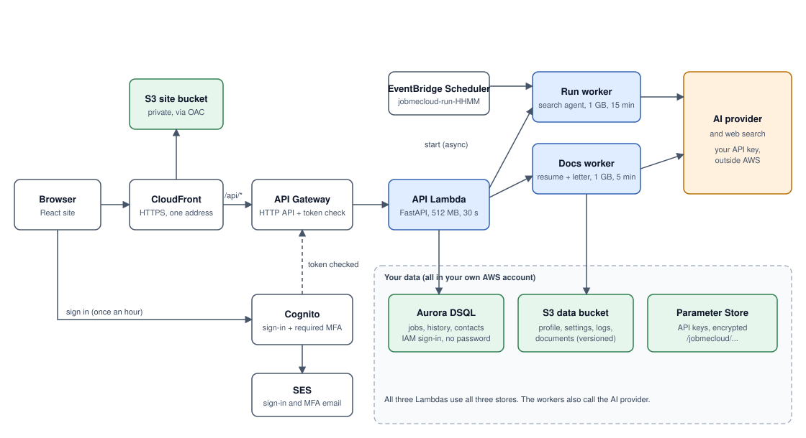

# How JobMeCloud works: an architecture guide

Updated 17 Nov 2026. It follows the code as it is today; where something is not built or not yet proven, it says so. For the hands-on steps see [deploy.md](deploy.md). For the reasoning behind the original design see [the design spec](superpowers/specs/2026-11-14-aws-migration-design.md).

## 1. The 60-second answer

JobMeCloud is a job-search assistant that runs entirely in your own AWS account with no server to look after. A React website is served from S3 through CloudFront. A FastAPI app runs inside a Lambda behind API Gateway. Two more Lambdas do the slow work: one runs the search (or reads and scores an emailed report), one writes a tailored resume and cover letter. An optional fourth Lambda receives emailed reports. Jobs and history live in Aurora DSQL, files live in S3, API keys live in Parameter Store, sign-in is Cognito with required two-step verification, and EventBridge Scheduler starts the automatic searches. Nothing has a fixed monthly fee, so one person's AWS bill is about $0 to $2. The AI provider is the real cost, and the app caps it. Runs can be started two ways: an AI-driven web search (costly: one run cost $0.70 to $2.10 when measured) or, optionally, a daily report that another tool emails to the app, which the app researches itself (about $0.07 for a one-role report).

The application code is the earlier local JobMe app (one real agent, a plain-code pipeline around it) ported to the cloud. This guide is mostly about what the move to AWS changed.

Three ideas carry the design:

1. **Pay for use, not for existence.** No VPC, NAT gateway, database instance, load balancer or provisioned capacity. Every service either has a free allowance or charges per request, so an idle app costs almost nothing.
2. **A Lambda is disposable, so nothing lives inside one.** Each invocation starts with an empty `/tmp`. State goes to Aurora DSQL (rows), S3 (files) or Parameter Store (secrets), and the code copes with a stale or half-finished invocation.
3. **Bound everything, and fail where it is cheap.** Lambda time limits, per-run spending caps, one run at a time, no automatic retries of workers, and a $5 budget alert. An unattended app that can spend money needs hard limits.

## 2. Vocabulary

| Term | Plain meaning | Where it is here |
|---|---|---|
| Serverless | You upload code and AWS runs it on demand. No machine to patch | All the Lambdas |
| Lambda | A function that runs when called, for up to 15 minutes, then disappears | `handlers/api.py`, `run_worker.py`, `docs_worker.py` |
| Layer | A shared zip of libraries that several Lambdas attach | `DependenciesLayer`, built by `scripts/build_lambdas.py` |
| HTTP API | API Gateway's cheap, fast front door | `Edge` in `infra/edge.py` |
| JWT authorizer | API Gateway checks a signed token before your code runs | Every `/api/*` route |
| CloudFront / OAC | A CDN in front of the site. Origin Access Control lets only CloudFront read the private bucket | `infra/edge.py` |
| Aurora DSQL | A serverless, PostgreSQL-compatible database with no instance to size | `db/engine.py` |
| DPU | DSQL's billing unit. 100,000 a month are free | [costs.md](costs.md) |
| IAM token auth | The database has no password. Code signs a short-lived token with its IAM role | `dsql_creator` in `db/engine.py` |
| OCC conflict | DSQL's optimistic concurrency: two writers collide and one is told to retry (SQLSTATE `40001`) | `db/retry.py` |
| SSM SecureString | An encrypted value in Parameter Store | `secrets.py` |
| EventBridge Scheduler | A managed cron that can invoke a Lambda in your time zone | `scheduling/eventbridge.py` |
| CDK | Infrastructure written as Python that CloudFormation then applies | `infra/` |
| Workspace | The S3 prefix `workspace/` mirrored into a Lambda's `/tmp` | `storage/workspace.py` |
| Dispatcher | Starts long work: a worker Lambda in AWS, a thread on a laptop | `jobs/dispatch.py` |
| DKIM | A signature a mail provider adds so a receiver can tell a message really came from that domain | `inbound/trust.py` |
| SES receiving | SES accepting email for an address you own and storing it in a bucket | `infra/inbound.py` |
| Agent loop | The model chooses tools in a loop until done or a limit is hit | `llm/loop.py` |

## 3. The big picture



Blue boxes are code you deploy. Green boxes hold your data. Orange is outside AWS. Everything inside the dashed area is in your own account, and the project operates no servers.

**A normal request.** The browser loads the site from CloudFront (S3 behind it). The site redirects to Cognito's hosted sign-in page, you sign in with your password and a second factor, and Cognito sends back a token. Every call to `/api/...` carries that token. CloudFront forwards `/api/*` to API Gateway, which checks the token's signature and audience against your user pool. Only then does the API Lambda run.

**Long work never runs inside a web request.** "Run now" and "Make docs" ask the API Lambda to invoke a worker Lambda asynchronously and return at once. The browser polls for progress.

## 4. AWS resources in the stack

All of this is created by `cdk deploy` from [`infra/`](../infra). Names are the CDK ids.

| Resource | CDK id | Settings that matter | Why |
|---|---|---|---|
| Aurora DSQL cluster | `Database` | Deletion protection on | The database. Serverless and free at this size |
| S3 bucket (data) | `DataBucket` | Versioned, private, encrypted, HTTPS only, **retained** on destroy | Resumes, profile, settings, run logs, documents |
| S3 bucket (site) | `SiteBucket` | Private, encrypted, retained | The built website |
| Lambda layer | `DependenciesLayer` | arm64, Python 3.12 | FastAPI, SQLAlchemy, psycopg, boto3, the AI SDKs |
| Lambda: API | `ApiFunction` | 512 MB, 30 s, can save or delete API keys | The web app, via Mangum |
| Lambda: run worker | `RunWorkerFunction` | 1024 MB, **900 s**, no automatic retries | The search run |
| Lambda: docs worker | `DocsWorkerFunction` | 1024 MB, 300 s, no automatic retries | One job's resume and cover letter |
| Log groups | `*Logs` | 14-day retention | Named `JobMeCloud-ApiLogs...`, not `/aws/lambda/...` |
| Cognito user pool | `UserPool` | Essentials plan, MFA **required** (authenticator app or email), no sign-up, no password reset, 12-character passwords, deletion protection | The one account |
| Cognito app client | `SpaClient` | Authorization-code flow, no secret, 1 h tokens, 30-day refresh | The browser app |
| Cognito domain and branding | `LoginDomain` | Managed login (the newer version) | The hosted sign-in page |
| API Gateway HTTP API | `Api` | Single route `/api/{proxy+}`, JWT authorizer | Front door for the API Lambda |
| CloudFront distribution | `Distribution` | Default behaviour to S3 via OAC, `/api/*` to API Gateway, caching off for the API; optionally your own hostname and an ACM certificate from `us-east-1` | One HTTPS address for site and API |
| Scheduler IAM role | `SchedulerRole` | Can invoke only the run worker | What EventBridge Scheduler assumes |
| AWS Budget | `MonthlyBudget` | $5 monthly, email at 80% actual and 100% forecast | A spending alert, not a spending stop |
| *Optional:* mail bucket, SES receipt rule set, ingest function | `Inbound` | Private bucket with 30-day expiry, one rule for one address, 512 MB and 10 minutes | Emailed reports ([email-ingest.md](email-ingest.md)) |

**Created later by the app, not by CDK:**

- EventBridge schedules named `jobmecloud-run-HHMM`, made when you save a schedule in Settings. The API's role may touch only schedules with that prefix.
- Parameter Store entries `/jobmecloud/provider/<id>` and `/jobmecloud/search/<name>` when you save an API key.
- Objects under `workspace/` in the data bucket.

**Done by hand, once:** the AWS account and its root-user MFA, a billing budget, IAM Identity Center admin user, `cdk bootstrap` (a small staging bucket and roles for deployments), and a verified SES email identity (the account starts in SES sandbox, which suits one recipient).

**Deliberately not used:** VPC, NAT gateway, EC2, load balancer, Route 53, WAF, custom KMS keys, DynamoDB, SQS. Each adds a fixed cost or setup the app does not need.

## 5. Map of the code

All Python is under `backend/jobmecloud/`. About 11,500 lines of Python in the backend, 10,000 in the website, 430 of CDK and about 100 test files.

| Area | Where | What it does |
|---|---|---|
| Lambda entry points | `handlers/` | `api` (Mangum around FastAPI), `run_worker`, `docs_worker`, `ingest` (emailed reports), and `common.bootstrap` |
| Web app | `api/app.py`, `api/routes_*.py` | FastAPI app and one router per area (jobs, runs, settings, schedule, ...) |
| Database | `db/engine.py`, `migrate.py`, `models.py`, `columns.py`, `retry.py`, `batch.py` | SQLite or DSQL, schema upgrades, key columns, conflict retries, batched writes |
| Files | `storage/workspace.py`, `storage/sync.py` | S3 to `/tmp` mirror, and the middleware that pulls and pushes it |
| Secrets | `secrets.py`, `llm/redact.py` | Parameter Store access, and key redaction in logs and errors |
| Long work | `jobs/dispatch.py`, `jobs/runlock.py` | Starting workers, and the one-run-at-a-time lock |
| Check a job | `jobs/check.py`, `jobs/duplicates.py`, `api/routes_check.py` | Read pasted text or a link, find duplicates, judge the fit |
| Job status | `jobs/tracking.py`, `jobs/status.py` | Which moves each status allows, and the history written for each |
| Emailed reports | `inbound/` | Parse and trust-check an email, pick out the recommended roles, record each email's outcome, replay |
| Scheduling | `scheduling/eventbridge.py`, `api/routes_schedule.py` | Turns your days and times into EventBridge schedules |
| Search agent | `llm/loop.py`, `agents/jobscout/` | The loop, its tools, and the pipeline around it |
| Documents | `applydocs/` | Draft, self-check, revise, code check, render |
| Providers | `llm/*_provider.py`, `factory.py`, `steps.py`, `pricing.py` | Anthropic and OpenAI-compatible adapters, per-step model choice, cost cap |
| Admin scripts | `admin/`, `scripts/` | Build, migrate, create or reset the owner, publish the site, import local data |
| Infrastructure | `infra/` | The CDK app: stack, auth, edge |
| Website | `frontend/src/` | React, PKCE sign-in in `auth.ts`, API client in `api.ts`, the menu count in `followUps.ts`, the Check a job panel in `components/CheckJobPanel.tsx` |

Reading order for the cloud parts: `db/engine.py`, `storage/workspace.py`, `handlers/common.py`, `handlers/run_worker.py`, `jobs/dispatch.py`, `jobs/runlock.py`, then `infra/jobmecloud_stack.py`.

## 6. How the pieces work together

### Signing in

```
browser --> CloudFront --> site (S3)                      load the page
browser --> Cognito hosted page                          redirect (authorization code + PKCE)
you     --> password, then authenticator code or email code
Cognito --> browser                                       code, exchanged for tokens
browser --> /api/... with "Authorization: Bearer <token>" every call
```

Cognito issues tokens that last an hour, with a refresh token for 30 days. There is no sign-up and no Google login, because Cognito does not apply MFA to federated users. Email codes are sent through SES, which is why your address must be verified there.

### One API call

1. CloudFront forwards `/api/*` (caching off) to API Gateway.
2. API Gateway's JWT authorizer verifies the token. Failure returns 401 and no Lambda runs.
3. The API Lambda starts, or reuses a warm copy. On first use `create_app()` builds the app, **pulls the S3 workspace to `/tmp`**, connects to DSQL and runs.
4. `WorkspaceSyncMiddleware` pulls again if more than 10 seconds have passed (a worker may have written files), and **pushes** after any successful write request.
5. `ConflictRetryMiddleware` replays a write once if DSQL reports a conflict, then answers 409.

### "Run now" and the schedule

```
Run now:   browser -> API Lambda -> creates a Run row -> invokes RunWorker (async) -> returns 202
Schedule:  EventBridge Scheduler ---------------------> invokes RunWorker  {"trigger": "schedule"}

RunWorker: pull workspace -> take the run lock -> search agent -> read, check and score jobs
           -> record each job in DSQL -> release lock -> push workspace
```

- The run worker has 15 minutes, the Lambda maximum. It checks the remaining time as it works and **stops starting new jobs when under 90 seconds remain**, then records "Stopped early to stay within the time limit." Whatever was found is saved.
- Workers are **never retried automatically**. A failed run is written onto its Run row. An automatic retry would start a duplicate run.
- The **run lock** is a row in DSQL with a heartbeat. A second run is refused, and a run that died frees itself after about ten minutes. It is written without `SAVEPOINT`, which DSQL does not support.

### Emailed reports (optional)

With `inbound_address` and `inbound_sender` set, a daily report emailed to a dedicated address starts a run, instead of the search agent paying for a web crawl:

```
report email -> SES receiving rule -> raw email in the mail bucket -> ingest Lambda
  (checks sender, address, spam, DKIM; records it; takes the run lock; creates Run(trigger="email"))
  -> run worker with the email's key: one AI call picks the recommended roles
  -> the usual read, dedupe, liveness, rules, score -> documents for matches above the cutoff
```

Only the source of candidates differs. Everything after it, including the single run lock and the per-run spending cap, is the same code. Every received email gets an `InboundEmail` row (received, started, rejected, skipped, waiting, done, failed), which makes ingestion idempotent and replayable. See [email-ingest.md](email-ingest.md).

### "Make docs"

The API starts the docs worker and returns 202. The page polls `/api/jobs/<id>/docs/status` until the job's `docs_status` is `ready` or `error`, giving up after six minutes. The worker takes the same lock, so documents and a run never overlap. Files are written into the workspace, pushed to S3, and downloaded through a link that expires in 15 minutes.

### Checking a job

The API Lambda has three routes for this: `POST /api/jobs/check` reads pasted text or a link (a link is fetched with a 10 second limit, never for private or LinkedIn addresses) and saves a New job; `GET /api/jobs/check/models` lists the connected AIs, scoring model first; `POST /api/jobs/{id}/fit` judges a saved job with the chosen one. Reading uses the extraction step and judging uses the scoring code a run uses. Neither call has tools, so pasted text cannot make the app do anything. The job is saved before judging, and a failed judgment changes nothing. One duplicate finder (`jobs/duplicates.py`) serves this and Add a job: the same requisition, the same employer and title, or the same address is the same job, and two different requisitions never are. A duplicate that was added without details (an import, or by hand) learns them from the pasted posting. Because the API function stops at 30 seconds, the fetch and the AI call share a 24 second budget and end in a plain "took too long" message rather than being cut off. Guide: [check-a-job.md](check-a-job.md).

### The Follow-ups number

`GET /api/followups/counts` returns how many follow-ups are overdue and due today, using the app's own idea of today. The menu shows the total beside **Follow-ups** (red when anything is overdue). The website refreshes it on load, on every page change, when the window regains focus, every five minutes, and a moment after any successful change, which the API client announces with a browser event.

### Status

A job's status moves by rules in `jobs/tracking.py`, which also says which moves each status allows. People set Applied, Interviewing, Offer, Accepted, Rejected, Withdrawn, Skipped and Unavailable (gone, or not one you can pursue). The app itself only ever sets New, Ready and Closed. Reopen returns a finished job to New or Ready. The Jobs list and the job page both read the allowed moves from the server, so they never disagree.

### Files: the workspace pattern

The code reads and writes ordinary files under one folder. In Lambda that folder is `/tmp/jobmecloud`, so instead of teaching every call site about S3, each invocation **pulls** the S3 prefix into `/tmp` at the start and **pushes** what changed at the end. A manifest of file hashes tells it what changed, and a file it pulled and later finds missing is deleted from S3. SQLite files are never synced, because the database is DSQL. Layout:

```
workspace/settings.yaml
workspace/profile/...        resumes and the search profile
workspace/logs/...           one transcript per run
workspace/applications/...   generated documents, one folder per job
```

### Claude Desktop access

A second front door for Claude Desktop. `POST /api/mcp` (`api/routes_mcp.py`) speaks stateless MCP (JSON-RPC) and is the only API Gateway route without the JWT authorizer. It checks a bearer key (`keys/store.py`: random, hashed, scoped `read` or `readwrite`, revocable, with a per-minute and a daily AI-spend limit) and then runs a tool from `mcp/`. Each tool calls one of the app's own routes in-process (`mcp/registry.py`, a `TestClient`), so validation, history and S3 sync match the website; a context variable (`jobs/actor.py`) records the change as "claude:key name". The one tool that writes files, `attach_documents` (`applydocs/attach.py`), puts a chat-written resume or cover letter into the job's folder. Keys are made in Settings (`api/routes_keys.py`, `sections/ClaudeAccessSection.tsx`). See [claude-desktop.md](claude-desktop.md).

## 7. The database layer

The same models run on SQLite (laptop and most tests) and on Aurora DSQL. `make_engine()` picks by URL: `dsql://<endpoint>` for the cloud. DSQL is PostgreSQL-compatible but not PostgreSQL, so these rules shaped the code:

| DSQL rule | What the code does |
|---|---|
| No password: sign a token with IAM | `dsql_creator` signs a fresh token per connection. Connections are recycled before the one-hour limit |
| No `SAVEPOINT` | SQLAlchemy's driver looks up the `hstore` type inside one, so DSQL connections turn that off. The run lock is written without savepoints |
| Optimistic concurrency | `retry_on_conflict` retries on `40001` and `OC000`/`OC001` with backoff. Each retry opens a fresh session |
| At most 3,000 rows per transaction | Imports commit in batches of 500 (`chunked`) |
| Identity columns must be `bigint` with `CACHE 1` or 65,536 or more | `pk_column()` uses `CACHE 1` so ids stay sequential |
| DDL and DML cannot share a transaction | `migrate()` runs each step in its own transaction |
| Indexes build asynchronously | `CREATE INDEX ASYNC` |
| `ADD COLUMN` takes no default | Add the column, then backfill |

`scripts/migrate_db.py` creates or upgrades tables and is safe to repeat. A test marked `dsql` runs the schema against a real cluster, because SQLite cannot show these limits.

## 8. The agents (carried over from JobMe)

The agent layer is unchanged in design. A short summary:

- **One real agent: the search agent.** `llm/loop.py` is a hand-written loop of about 70 lines. Each turn it checks the limits, asks the model, keeps the reply exactly as given, and runs any tools the model asked for. Tools: search the web, fetch a page, check whether a job was seen, record a candidate. Limits: 40 turns, a spending cap, a search budget, 40 candidates.
- **Everything else is a workflow.** Reading a posting, checking if it is still open and scoring it are single structured calls inside a plain-code pipeline (`agents/jobscout/pipeline.py`). Code decides order and rules. The model proposes and code checks.
- **ApplyDocs** drafts a resume and cover letter, asks the model to check its own claims against the master resume, revises once if needed, then runs a code check on numbers, skills and banned terms before writing files.
- **Per-step models.** Five steps (search, extract, liveness, score, tailor) each pick a provider and model in Settings, so cheap steps can use a small model.

What the cloud added around it:

| Concern | Local app | JobMeCloud |
|---|---|---|
| Where it runs | A thread in the app | A 15-minute worker Lambda |
| Where candidates come from | The search agent | The search agent, or an emailed report that another tool sent (optional) |
| Time limit | None | Stops starting work with 90 seconds left |
| Duplicate runs | A lock | The same lock, in DSQL, with a heartbeat |
| Retries | n/a | Turned off for workers |
| API keys | Windows credential store | Parameter Store; the API can write them, workers can only read |
| Key leaks | n/a | Keys are redacted from logs and error messages |

## 9. Security model

Layers, from the outside in:

1. **Account:** your account is the boundary. Use IAM Identity Center and lock away the root user.
2. **Edge:** HTTPS only. The buckets are private and the site is reachable only through CloudFront.
3. **Identity:** password plus a required second factor, no sign-up, no password reset (recovery is the `reset_owner` script).
4. **API:** API Gateway verifies the token before any code runs.
5. **Permissions:** least privilege where practical. The scheduler role can invoke only the run worker. The API can manage only `jobmecloud-run-*` schedules and may pass only the scheduler role. Only the API can write secrets.
6. **Data:** encrypted at rest and in transit, versions kept on the data bucket, deletion protection on the database and the user pool.
7. **Output:** keys are redacted from logs. Posting text is untrusted input to the model.
8. **Inbound mail (optional):** SES accepts mail for one address only, scans it, and the ingest function keeps it only if it is from your one sender with a valid DKIM signature; anything else is deleted at once. Each email is claimed atomically, so a repeat or concurrent delivery does nothing. The report text is untrusted: the AI call that reads it has no tools.

Honest limits are in section 12 and [security.md](security.md).

## 10. Cost model

About $0 to $2 a month in AWS for one person, mostly free allowances. The AI provider is the real cost. Measured: a web-search run $0.70 to $2.10 (nearly all of it input tokens, because the search results are large and are re-read inside one provider call), an emailed report about $0.07. Controls: a spending cap per run (default $2), searches per run (default 20), applications per run (default 10), cheaper models for the high-volume steps, and a $5 budget alert. A budget alerts and does not stop spending. See [costs.md](costs.md) for the per-service table.

## 11. Deploying and operating it

```
uv run python scripts/build_lambdas.py     build the layer and four zips (arm64)
cdk deploy -c owner_email=... -c sender_email=... -c timezone=...    (+ optional -c site_domain, certificate_arn, inbound_address, inbound_sender)
uv run python scripts/migrate_db.py        create or upgrade tables
uv run python scripts/create_owner.py --email ...
(cd frontend && npm run build) && uv run python scripts/publish_site.py
```

- **Updating** repeats those steps. Rebuild and redeploy after any backend change. Skipping that leaves the old code running, which happened during development (see the weak spots).
- **Coming from the local app:** `scripts/import_local.py` rehearses, then copies your jobs, history, files and settings ([migrating-from-local.md](migrating-from-local.md)).
- **Emailed reports:** `scripts/reprocess_email.py --list` shows each email and its status; `--key` replays a waiting or failed one ([email-ingest.md](email-ingest.md)).
- **Logs:** CloudWatch log groups `JobMeCloud-ApiLogs...`, `...RunWorkerLogs...`, `...DocsWorkerLogs...`, `...IngestLogs...`. Each run also writes a transcript under `logs/` in the data bucket.
- **Recovery:** [account-recovery.md](account-recovery.md). **Uninstall:** [operations.md](operations.md). Deletion protection and retained buckets mean `cdk destroy` leaves your data until you remove it on purpose.
- **Deploying with an assistant:** [prompts/deploy-with-an-agent.md](prompts/deploy-with-an-agent.md).

## 12. Honest weak spots and what is not built

- **Not built yet:** SES digest and reminder emails (outgoing mail is still only sign-in mail), the tool-using tailoring agent, the read-only external API, Bedrock as a model provider.
- **Proven on a real account:** sign-in, the database layer, importing data, a schedule firing on its own, an AI web-search run, a custom hostname, an emailed report from receipt to scored role with written documents, and Check a job (deployed, and confirmed working by the owner; which paths were tried was not recorded). **Not yet observed:** a long unattended stretch of daily emailed reports.
- **Web-search runs are expensive** (see section 10), and the spending limit is checked between AI calls, so one call can overshoot it. The emailed-report path avoids this by doing no AI search at all.
- **Check a job must answer inside the API function's 30 seconds.** It stops itself at 24 and says so, but the provider may still bill for a call that was given up on, and a database conflict replays the whole request, including its AI calls.
- **Inbound email rows are not pruned.** Raw mail expires after 30 days, but the small record of each email stays.
- **The ingest function connects as the database's admin role**, like every other function.
- **Every function uses the database's admin role.** The app creates and updates its own tables. A narrower role is planned for the external API.
- **Anyone with admin access to the AWS account can read everything.** There is no separate encryption layer.
- **One user, one tab.** Settings and files are shared in S3 and the last write wins. It is not built for teams.
- **15-minute ceiling.** A very large run is cut short, by design, and resumes on the next one.
- **Cold starts.** The first call after idle takes a few seconds while the Lambda builds the app and pulls the workspace.
- **No built-in export of the database.** DSQL keeps data redundantly, but there is no in-app backup button.
- **Tokens live in browser local storage.** Sign out on shared computers.
- **Sandbox email.** SES in sandbox mode can only send to addresses you verified, which is right for one person.
- **Tested mainly on Windows**, with Anthropic the most exercised provider.

## 13. Exercises

1. **Trace a request.** Open the site with browser developer tools, find a `/api/...` call, and follow it through CloudFront, API Gateway and the API Lambda's log group.
2. **Read a run.** After a run, open its transcript under `logs/` in the data bucket and follow each tool call.
3. **Break the lock.** In a test, take the run lock, then try a second run, then stop the heartbeat and watch the lock expire.
4. **Look at the schedule.** After saving a schedule, run `aws scheduler list-schedules` and read the cron expression and time zone.
5. **Read the diff.** Change a small thing and run `cdk diff` to see what CloudFormation would do before you deploy.
6. **Force a conflict.** Update the same row from two sessions against a DSQL cluster and see `retry_on_conflict` act.
7. **Draw it.** Redraw the architecture from memory, then compare with section 3.

## 14. One-page cheat sheet

- **Front:** CloudFront, one address. `/` is S3. `/api/*` is API Gateway, which checks the Cognito token.
- **Code:** API Lambda (512 MB, 30 s). Run worker (1 GB, 15 min). Docs worker (1 GB, 5 min). Ingest (512 MB, 10 min, optional). All arm64, Python 3.12, one shared layer.
- **Data:** Aurora DSQL for rows. S3 `workspace/` for files, mirrored to `/tmp`. Parameter Store `/jobmecloud/` for keys.
- **Start work:** the API invokes a worker asynchronously. Optionally, EventBridge Scheduler `jobmecloud-run-HHMM` starts a web-search run, or an emailed report arrives via SES to the ingest function, which starts the run worker.
- **Safety:** one run at a time (heartbeat lock), no worker retries, 90-second time margin, per-run spending cap, $5 budget alert.
- **Sign-in:** Cognito, password plus required MFA, no sign-up, recovery by script.
- **DSQL rules:** IAM token, no savepoints, retry on conflict, 3,000 rows per transaction (batch 500), identity `CACHE 1`.
- **After code changes:** build, `cdk deploy`, migrate, publish. Always.
- **Cost:** about $0 to $2 a month on AWS. The AI provider is the real bill.
